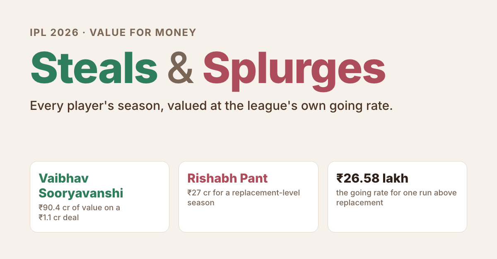

# IPL Steals & Splurges

Every IPL 2026 player's season, valued at the league's own going rate: who delivered more than they were paid, and who didn't.

**Live site:** https://tiwari-nikita.github.io/ipl-steals-splurges/

**Method, in short**
1. **Runs added.** For every ball, compare what happened with what an average team scores from that exact situation (balls left, wickets down), using an expected-runs table built from 2023–2026 first innings. Batters earn the difference; getting out costs runs; bowlers get the opposite. Each season is centred so the average player adds zero.
2. **Replacement level.** How minimum-price (≤ ₹50 lakh) regulars actually performed. Runs above replacement (RAR) = runs added − replacement rate × balls involved.
3. **Going rate.** Money teams spent above the ₹30 lakh minimum ÷ total positive RAR in the league. Value delivered = ₹30 lakh + RAR × going rate. Gap = paid − value delivered.
4. Players listed as withdrawn/injured are excluded. Keeping, fielding and captaincy are not counted.

**Data**
- Ball-by-ball: [Cricsheet](https://cricsheet.org/), Open Data Commons Attribution License.
- Salaries, retentions, auction prices and replacements: Wikipedia, [List of 2026 Indian Premier League personnel changes](https://en.wikipedia.org/wiki/List_of_2026_Indian_Premier_League_personnel_changes), CC BY-SA.
- Cross-check: Wikipedia's 2026 season page (top run and wicket totals).

**Rebuild and verify**
1. Download the IPL ball-by-ball JSON zip from [Cricsheet's downloads page](https://cricsheet.org/downloads/) and unzip it into `data/raw/cricsheet/json/`. The Wikipedia pages used are already in `data/raw/wiki/` (API copies, CC BY-SA).
2. Make a Python 3.12 venv in `.venv/` with pandas, numpy, duckdb and lxml.
3. Run `./run_all.sh`. It rebuilds every output, then `verify.py` re-derives the published numbers and cross-checks the season leaders against Wikipedia.

The site in `site/` is static and deploys to GitHub Pages on every push to `main`.

**Licences.** Data derived from Wikipedia is shared under CC BY-SA 4.0. Cricsheet data is under the Open Data Commons Attribution License.

Independent fan project. Not affiliated with the IPL, BCCI or any franchise. Built by Nikita Tiwari with AI coding assistance.
